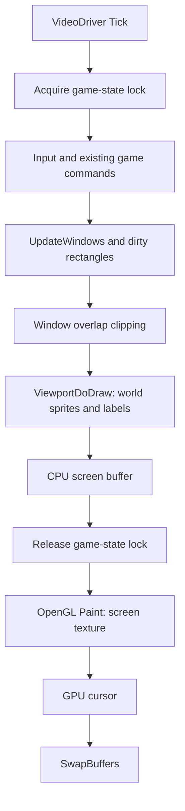
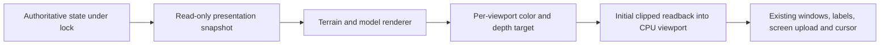

# Phase 0 architecture audit

Date: 2026-10-16. Source root: `OpenTTD-15.3/OpenTTD-15.3` relative to workspace. This is a source inspection, not proof that a proposed 3D integration runs. See build_and_test.md for build/runtime evidence.

## Provenance and scope

The supplied archive declares version 15.3 in CMakeLists.txt. It had neither `.git` nor `.ottdrev`; its exact upstream commit has not been verified. Workspace Git baseline is `b850d81` (local import, not an upstream revision). Git lives at workspace root so the original guide and source are tracked together; Godot binaries and build/runtime directories are ignored. OpenTTD's version script checks `.git` at its own source root, so this layout currently produces `norev0000`. Do not claim network compatibility or invent an upstream release hash. Decide verified upstream provenance and explicit fork build identification before multiplayer work.

Approved scope is base-game content only, an optional custom renderer, unchanged simulation, and retained classic GUI/2D mode. OpenGFX is a base graphics set, not a request to implement gameplay NewGRFs. Base sprites remain needed for menus, icons and classic rendering. No Godot dependency is proposed.

## Verified source map

Line references describe the untouched source import; function names are the durable references.

| Concern | Source and relevant entry points | Integration implication |
| --- | --- | --- |
| Simulation | `src/openttd.cpp:1210` StateGameLoop; `:1336` GameLoop | Leave economics, movement and networking untouched. |
| Frame scheduling and thread ownership | `src/video/video_driver.cpp:30` GameLoop, `:101` Tick | Tick locks game state around input and UpdateWindows, then releases it before Paint. GPU Paint must not traverse mutable map/vehicle/window state. Copy presentation data while locked. |
| Windows backend | `src/video/win32_v.cpp:1009` MainLoop; `:1576` Win32OpenGL::Paint | Existing OpenGL paint then cursor then SwapBuffers; GDI remains fallback. SDL2 OpenGL and Cocoa exist but are outside first implementation target. |
| GPU presentation | `src/video/opengl.cpp:738` PrepareContext; `:913` Resize; `:1039` Paint; `:1193` ReleaseVideoBuffer | Existing backend uploads and displays the CPU screen buffer, with palette/animation support. PrepareContext disables depth. Add depth-capable offscreen target and explicit GL state restoration; do not assume the window framebuffer has suitable depth. |
| World viewport | `src/viewport.cpp:1811` ViewportDoDraw; `:1903` Window::DrawViewport | Gathers landscape, vehicles, signs and effects, sorts sprites and draws overlays/strings into a clipped DrawPixelInfo. This is the preferred opt-in replacement boundary, not the simulation tile procedures. |
| GUI occlusion | `src/window.cpp:883` DrawOverlappedWindow; `:947` DrawOverlappedWindowForAll | Recursively splits visible rectangles around higher windows before calling OnPaint. There is no ready transparent UI-only texture. Preserve this behavior. |
| Projection | `src/landscape.h:82` RemapCoords; `src/viewport.cpp:430` TranslateXYToTileCoord | Projection is `(2*(y-x), x+y-z) * ZOOM_BASE`, then viewport zoom/offset. Match this affine projection exactly initially, including vertical scale; a generic 45-degree camera is not necessarily equivalent. |
| Height-aware inverse | `src/landscape.cpp:115` InverseRemapCoords2 | Uses iterative slope-height lookup. Matching the existing projection helps reuse it, but verify against rendered triangles, foundations, and edges. |
| Tile geometry | `src/tile_map.cpp:55` GetTileSlopeZ; `src/tile_map.h:268`; `src/landscape.cpp:174` ApplyFoundationToSlope, `:307` GetSlopePixelZ, `:386` GetFoundationSlope | Distinguish raw terrain corners from transport surfaces/foundations. Steep/half-tile geometry must follow existing rules. |
| Rail | `src/rail_cmd.cpp:309` GetRailFoundation; `:2422` DrawTile_Track; `src/rail_map.h` | Read tile track bits, rail type and signals; don't infer infrastructure from final sprite IDs. Reuse rules without changing them. |
| Bridges/tunnels | `src/bridge_map.h:45` IsBridgeAbove, `:76` GetOtherBridgeEnd, `:84` GetBridgePixelHeight; `src/tunnel_map.h:39` GetOtherTunnelEnd; `src/tunnelbridge_cmd.cpp:1292` DrawTile_TunnelBridge | Bridge decks coexist with lower tiles; render ramps/span/terrain separately. Preserve tunnel/depot hiding. |
| Vehicles | `src/vehicle_base.h:265` x_pos/y_pos/z_pos/direction, engine_type, vehstatus; `:587` Next; `:600` First; `src/vehicle.cpp:1121` ViewportAddVehicles | Snapshot positions, identity, visibility and consist relations. Original visibility filtering excludes VehState::Hidden. Sprite viewport hashes use 2D bounds and cannot blindly cull new meshes. |
| Dirty rectangles | `src/gfx.cpp:1452` DrawDirtyBlocks; `:1516` AddDirtyBlock; `src/viewport.cpp:2094` MarkAllViewportsDirty; `:2128` MarkTileDirtyByTile | Screen invalidation is not a complete persistent mesh invalidation API. Camera, world load, neighboring corners, bridges and moving geometry need explicit treatment. |
| Input/commands | `src/viewport.cpp:2474` PlaceObject, `:2495` HandleViewportClicked, `:3291` VpSelectTilesWithMethod; `src/rail_gui.cpp:105` and `:390` Command::Post calls | Keep GUI placement callbacks and command path. New picking supplies the same coordinate semantics; render callbacks must never post construction commands. |
| Base/mod graphics | `src/newgrf.cpp:1758` LoadNewGRF; `src/newgrf_engine.cpp:1105` GetCustomEngineSprite; `src/gfxinit.cpp`, `src/spritecache.cpp` | Base sprites and gameplay mods share graphics infrastructure. Do not delete NewGRF code to enforce MVP scope; opt out of 3D for unsupported content later. |
| Screenshots | `src/screenshot.cpp:381` RealMakeScreenshot and CurrentScreenCallback | A GPU-only overlay would not automatically appear in CPU-buffer screenshots. Include capture behavior in compositor design. |
| Existing tests | root CMakeLists.txt:291 catch_discover_tests; `src/tests/landscape_partial_pixel_z.cpp` | Run current CTest suite; add focused geometry/projection tests when implementation begins. |

## Existing frame flow

The game thread also acquires the game-state mutex. Do not retain simulation pointers in render work that outlives this lock. Mesh caches and visual interpolation must be disposable, never serialized into saves or fed back into commands/RNG.

## Proposed minimal integration

Use `ViewportDoDraw` as the presentation boundary and the existing OpenGL backend for GPU ownership. First prove a small offscreen framebuffer with color and depth attachments. Render a cube/flat patch, then copy its pixels into the existing clipped **32-bit** viewport buffer; leave normal window painting, labels and cursor ordering in place. Restrict the prototype to a verified supported 32-bit blitter/Windows OpenGL combination; unsupported combinations stay 2D.

This synchronous GPU readback is a deliberately bounded proof path: it lets the existing clipping, UI ordering, and CPU screenshots operate on an actual viewport image. It can stall the GPU and hold the game-state lock too long. It is not a performance-ready architecture or a commitment to permanent readback. Validate GL context/thread ownership at the call site, row orientation, pitch, alpha and channel order before adoption. Cache one viewport image per frame rather than rendering once per dirty fragment. Start with one viewport; explicitly exercise a second with independent camera/size before passing Phase 1.

After that proof, evaluate GPU-resident per-viewport render targets with a separate coverage mask/ordered overlay pass. Capture immutable geometry, camera and visible viewport rectangles while locked; perform GPU work after unlock. A solid fullscreen CPU texture cannot simply be placed over 3D: it contains the old world too. Likewise, drawing 3D over the full viewport rectangle would overwrite windows and world labels. Preserve overlap clipping and implement transparent coverage/labels intentionally. Benchmark the proof before selecting this more involved compositor.

No new rendering source files or build flags exist yet. Proposed `src/3d/` helpers would be registered through existing CMake source lists, with compile and client runtime opt-ins. Mode switches invalidate the full screen and all presentation caches; world load/new game resets caches. GPU init failure must return cleanly to classic mode.

## Ordered Phase 1 plan

1. Finish the baseline gate and settle the missing-library/runtime issues in build_and_test.md.
2. Add disabled-by-default build/runtime switches and explicit backend/blitter checks; prove untouched 2D startup and fallback.
3. Add framebuffer/depth resource lifecycle, capability checks, state restoration and resize teardown. Prove a depth-tested cube without simulation access.
4. Test the bounded readback path through ViewportDoDraw with a flat, known-coordinate patch. Preserve window clipping and label ordering; restore GL bindings, viewport, blend/depth state and pixel packing.
5. Test overlapping windows, tooltips, dropdowns, cursor, DPI scaling, window resize, pan/zoom, and a secondary viewport. Check palette animation and screenshot correctness.
6. Toggle 2D/3D repeatedly, including new game and load; pause/speed/save/load smoke tests. Measure readback and frame costs before selecting the next compositor step.
7. Record defects/demo steps and commit a passing proof. Only then implement real terrain and early picking in Phase 2.

## Risks and explicit limits

- No performance claims from source inspection. Full-map mesh rebuilding per frame is not acceptable; visible chunks and affected-neighbor invalidation are later requirements.
- OpenTTD sprite-oriented dirty bounds and hidden-state rules need examination for every supported mesh category.
- Vehicle discrete turns are accepted for the first route. Cosmetic interpolation must handle teleport/load/depot transitions and remain detached from simulation.
- Additional viewports, window movement, map scrolling and labels can expose stale clipping/image-cache bugs; test early.
- The ordinary save format stays unchanged. Network version identification is a separate issue from deterministic behavior and currently unresolved for the archive.
- NewGRF 3D models, billboards, custom industries/stations/vehicles and arbitrary mod compatibility are deferred. Retain original 2D support.
- License inventory: supplied COPYING.md and source headers specify GPL v2; bundled third-party code has its own notices. Preserve these, keep source/build instructions with releases, and maintain a separate provenance/license manifest for every future model/texture/font. No new art has been generated.
