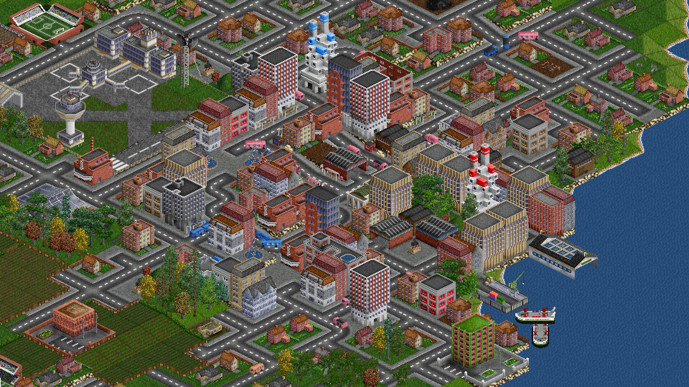
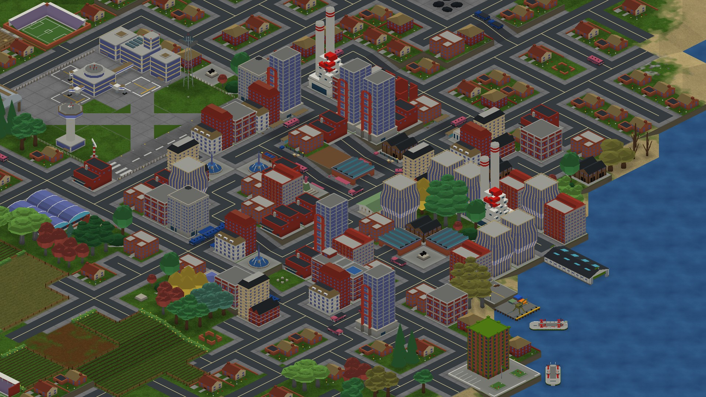
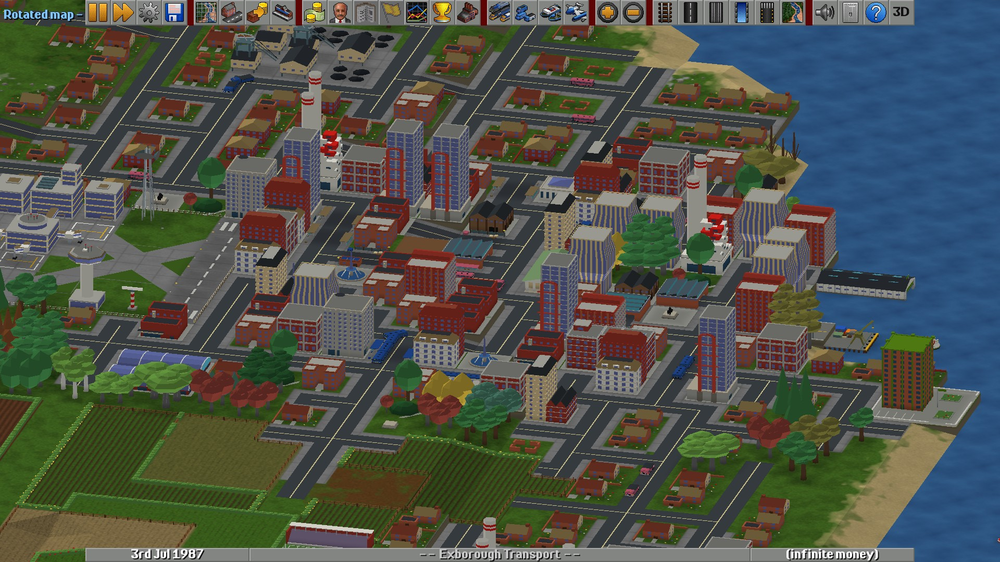
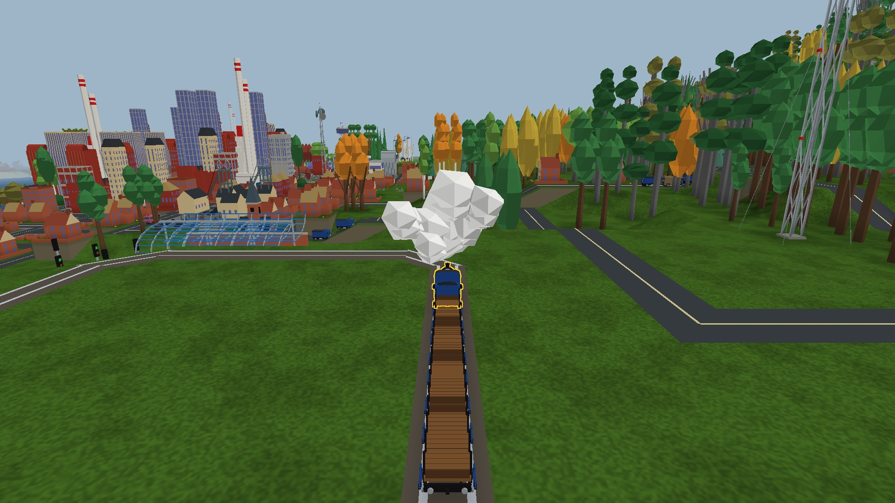
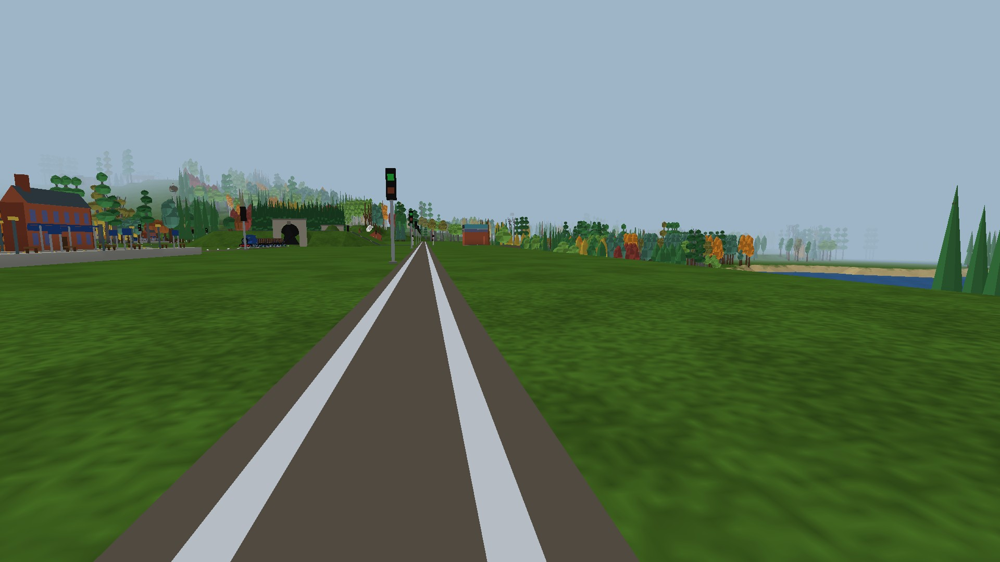
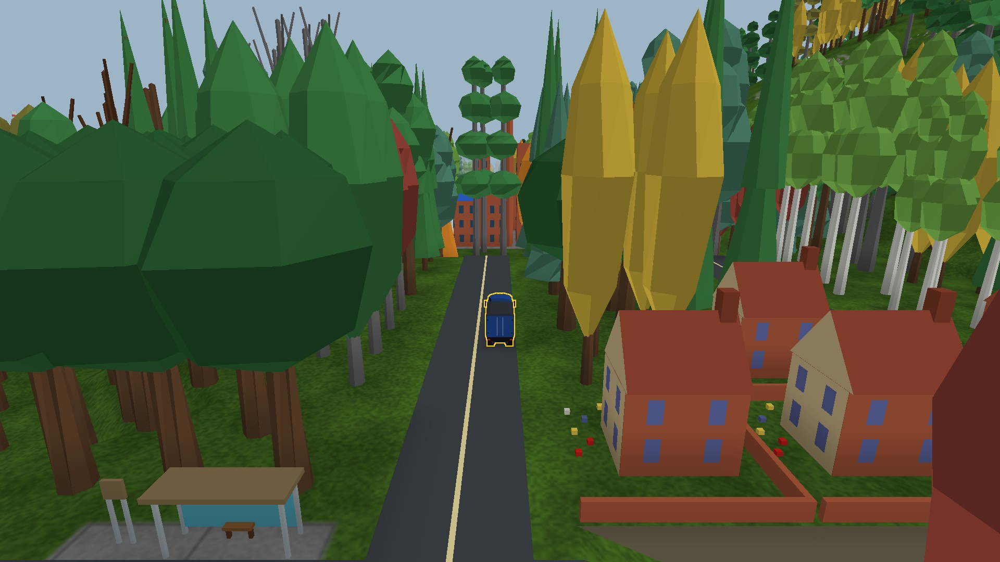

# OpenTTD 3D

**A full 3D view for OpenTTD.** Switch between the classic view and 3D at any time, rotate and tilt the camera, keep building at any angle, and ride along in your trains and trucks.

▶️ **[Watch the trailer on YouTube](https://www.youtube.com/watch?v=pnWwmM3cDPk)**

> This is an unofficial fan project based on OpenTTD 15.3. It is not affiliated with or endorsed by the OpenTTD team. It is an early alpha, so expect rough edges.

## Screenshots

| Classic | Same view in 3D |
|---|---|
|  |  |

**Rotated city, while you play**

| Chase view | Cab view | On the road |
|---|---|---|
|  |  |  |

## Features

- **Classic or 3D, your choice.** Toggle at any time, in a running game. The 3D view lines up with the classic one, so nothing jumps.
- **Free camera.** Rotate, tilt and zoom around your network.
- **Build at any angle.** Construction tools, vehicle clicks and station windows work in rotated views.
- **Ride along.** Cab and chase cameras for trains and road vehicles, right from the vehicle window.
- **Shadows and textured ground** for depth, with classic lighting available.
- **Uses the normal game.** Same rules, same saves, OpenGFX graphics included.

## Download and play

1. Download **[OpenTTD-3d-alpha1-01-windows-x64.zip](OpenTTD-3d-alpha1-01-windows-x64.zip)**. Click it, then the download button.
2. Unzip the whole folder somewhere you can write to, such as your Desktop or Documents. Program Files won't work.
3. Double-click **`Play OpenTTD 3D.cmd`**.
4. Start a new temperate game, or load one of your saves.

It runs from its own folder and keeps its own settings and saves, so it won't touch your normal OpenTTD install.

**Requirements:** Windows 10 or 11 (64-bit) and a graphics card with OpenGL support.

## Controls

| Input | Action |
|---|---|
| `,` / `.` | Rotate left / right |
| Page Up / Page Down | Tilt toward top-down / toward the horizon |
| Hold middle mouse + drag | Free orbit |
| Ctrl + right-drag | Free orbit (alternative) |
| Home | Switch between the classic angle and your last rotated angle |
| Mouse wheel | Zoom |
| Camera button in a vehicle window | Cycle normal → cab → chase view |
| **3D** button on the toolbar | 3D settings and camera help |

Keys can be rebound in `hotkeys.cfg`. If you ever have a graphics problem, open the console with the backtick key and type `renderer_3d off` to return to classic rendering.

## Alpha limitations

- Windows (OpenGL) only for now.
- Made for the **temperate** climate. Other climates have unfinished art.
- NewGRFs are turned off by the launcher.
- Sound and music are off in this build.
- Multiplayer with official OpenTTD or other builds hasn't been tested.
- Back up any saves you care about before trying it.

## Bug reports

Please open an issue with:
- your graphics card and driver version, and your Windows display scaling
- map size, and which camera you were using (classic, rotated, cab or chase)
- steps to reproduce, plus a screenshot and a save if you can
- whether the problem also happens with `renderer_3d off`

The zip includes a `build-info.json` file; attaching it helps identify the exact build.

## Credits and licence

Built on [OpenTTD](https://www.openttd.org), the open-source transport simulation game, and its [OpenGFX](https://github.com/OpenTTD/OpenGFX) graphics. OpenTTD is licensed under the GNU General Public License v2. Licence notices for OpenTTD, OpenGFX and the included libraries are in the zip (`COPYING.md`, `README.md` and the `licenses` folder).
